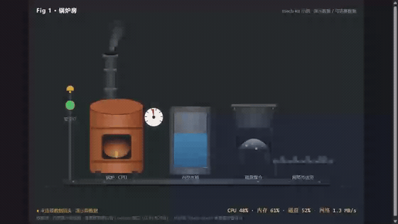
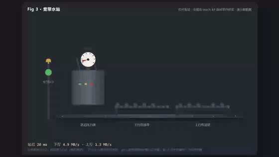

# mach-kit · 把看不见的状态拼成一台会动的机器

**mach-kit** 是一个零依赖的 SVG「机器零件库」：压力表、水箱、煤仓、传送带、锅炉、烟囱、警示灯、摆钟……
把任何枯燥的数字状态——CPU、网络延迟、心率、库存、销售额——拼装成一台**会动、会报警、一眼看懂**的机器。

> **English TL;DR:** mach-kit is a zero-dependency SVG part library that turns invisible state (CPU load, latency, heart rate…) into living isometric machines: gauges, tanks, conveyor belts, boilers, smokestacks, alarm lamps. `new Machine(...)`, drop parts with `m.create(Gauge, {...})`, feed values with `part.set(v)`. No build step, no framework, no npm install — one `.mjs` file.

## 三台样机（都是这套零件拼的）

| 锅炉房 —— 电脑/服务器的状态 | 家用钟表屏 —— 健康数据 | 宽带水站 —— 家里网线的状态 |
| --- | --- | --- |
|  |  |  |
| CPU=锅炉压力表 · 内存=水箱水位 · 磁盘=煤仓存量 · 网络=传送带速度。过载：红灯狂闪、烟囱冒黑烟、炉火烧到底 | 心率=摆锤节奏 · 血压=表盘 · 血氧=炉火旺衰 · 体温=水银柱。血氧一低：铃铛摇、横幅变红、炉火熄 | 延迟=压力表（越低越好）· 下行/上行=两条传送带。断网：灯红、传送带停 |

第三个例子**没有新增任何零件**——全部用现成件拼出来，这就是这个库要证明的事：**拼一台新机器，不需要会画画，只需要会选件**。

## 为什么

数字没有画面。`CPU 92%` 和 `CPU 43%` 是两个数字；「锅炉烧红了、烟囱冒黑烟、警示灯狂闪」是一个**一眼就懂的状态**。

mach-kit 的目标：**外行 10 秒读懂机器好不好**——不用培训、不用读文档、不需要认识英文缩写。它适合挂在监控大屏、老人房间的平板、店面看板、个人仪表盘上当"状态挂画"。

## 快速上手

```bash
node serve.mjs        # 零依赖静态服务器，默认 http://127.0.0.1:8787/
```

> 为什么需要服务器：示例用 ES 模块（`import`），双击 `file://` 打开会被浏览器拦截，必须经 HTTP 访问。

或者把 `src/mach-kit.mjs` 拷进你自己的静态站点，十几行拼一台机器：

```html
<div id="mount"></div>
<script type="module">
  import { Machine, Base, Gauge, Lamp, alarmLevel } from "./src/mach-kit.mjs";

  const m = new Machine({ w: 960, h: 540, theme: "dark", width: 900 });
  m.mount("#mount");
  m.create(Base, { x: 120, y: 430, w: 800 });          // 底座：所有机器都站在地上
  const g = m.create(Gauge, { x: 260, y: 250, r: 34, label: "延迟ms", min: 0, max: 300 });
  const lamp = m.create(Lamp, { x: 90, y: 250, label: "宽带状态" });

  // 数据从哪来是页面的事（轮询 / WebSocket / 表单 / 假数据），喂给零件就行：
  g.set(34);
  lamp.set({ level: alarmLevel(34, { yellow: 120, red: 200 }) });
</script>
```

## 零件清单（v0.2）

**动态零件（12 个）——喂值就动：**

| 零件 | 喂什么 | 动起来的是什么 |
| --- | --- | --- |
| `Gauge` | 数值（min–max） | 压力表指针 ±120° |
| `Tank` | 0–100 | 水箱水位升降 |
| `Bunker` | 0–100 | 煤仓煤堆高低（含玻璃反光、底煤） |
| `Belt` | 速度值 | 传送带虚线与货块滚动 |
| `Boiler` | 0–1 | 炉火亮度（闪烁） |
| `Stack` | 0–1（第二参 `true`=黑烟） | 冒烟频率/浓度/颜色（6 团摆动膨胀） |
| `Lamp` | `{level:0\|1\|2, shake}` | 绿/黄/红灯 + 红闪 + 顶铃摇 |
| `Bell` | `{on}` | 铃晃 + 声波圈扩散 |
| `Pendulum` | bpm | 摆锤节奏（每分钟 bpm 个来回） |
| `Flame` | 0–1 | 三层火苗 + 白热芯 + 飞火星 + 地面光晕 |
| `Thermo` | 温度值 | 水银柱升降 |
| `ClockFace` | 不用喂 | 真时钟，时/分/秒针自动走 |

**结构件（静态）：** `Base` 底座 · `Plate` 铭牌 · `WoodCase` 木壳钟柜 · `Banner` 状态横幅 · `Raw` 逃生舱（页面自画边角料，占比应越来越少）。

## 喂数约定（一套，全库统一）

- `set(数字)` = **目标值**：Machine 的循环里统一缓动（起步快、到站缓），零件自己不发明节奏；
- `set(对象)` = **复合状态，立即生效**（如警示灯 `{level, shake}`、横幅 `{text, ok}`）;
- 烟/火苗/摆/传送带/走时这类**时间驱动动画**由零件内部 `tick` 驱动，照常喂值；
- 报警阈值**不属于零件**：`alarmLevel(v, {yellow, red})` 返回 0/1/2，什么算"过高"由你的场景决定。

## 主题

内置 `dark`（工业深色）与 `warm`（暖木家居）两套 token 齐备的主题，`new Machine({ theme: "warm" })` 一词切换、零件零改动。新主题 = 补一张 token 表。

## 工艺三条（拼机器时请遵守，也是库内部的纪律）

1. **线条要落在实体上**——没有悬空的表、悬空的字、悬空的管子；
2. **渐变只给面、不给线**——SVG 在 `<line>` 上描渐变不可靠（踩过的坑），线一律实色；
3. **四色着色 + 画家顺序**——受光面/中间调/暗部/反光各归其位；先画后面的，再画前面的。

## 架构：这个库只管渲染

推荐三层：**数据适配器 → 指标接口 → 机器渲染层**。换数据源（本机 → Prometheus → 传感器）只换前两层，机器一个零件都不用动。mach-kit 就是干净的第三层：不联网、不碰存储、不知道数据从哪来。

两个完整例子：
- `examples/boiler.html` 演示了"演示数据 → 可选 `/metrics` 真数据"的降级接法；
- `examples/clock.html` 演示了"演示数据 / CSV 回放 / 手动录入（localStorage）"三源切换，健康数据全程不出本机。

### 附赠：健康数据 CSV 适配（`src/health-data.mjs`）

钟表屏那一套数据管线也在库里，全部**页内解析、不发任何请求**。契约格式：表头 `时间,心率,收缩压,舒张压,血氧,体温`（心率必需）。

| 导出 | 干什么 |
| --- | --- |
| `parseHealthCSV(text)` | 严格解析契约 CSV → `{ rows, skipped }` |
| `convertHealthText(text)` | **宽容转换**：品牌手环导出 CSV（表头别名自动识别：timestamp/heart_rate/spo2/高压低压…）与 Apple 健康 `export.xml`（HeartRate/OxygenSaturation/血压等 Record 按分钟聚合）→ 转成契约 CSV |
| `convertHealthCSV(text, userMap?)` | CSV 专路转换；`userMap` 指定 `{字段: 列名}` 兜底手工映射 |
| `peekCSVHead(text)` | 只取表头列名（给"列映射"兜底 UI 用） |
| `applyRow(T, row)` / `HEALTH_SAMPLE_CSV` / `toContractCSV(rows)` | 行喂页面目标值 / 一夜示例数据 / 行集转契约 CSV |

转换自带时间归一（`2026/11/12`、`2026年11月12日`、epoch 秒/毫秒 → `YYYY-MM-DD HH:MM`）与单位归位（血氧 0~1 小数 ×100、华氏转摄氏）。

## 现状与路线

**v0.2 实验期。** 杠杆已验证（三台机器、其中一台零新零件）；火苗/烟囱/煤仓已按上面三条工艺升级过一轮，但整体仍未做解剖级审查——**它现在"够看"，还没到"惊艳"**。

路线（按需，不画大饼）：
- 更多零件：水管、水位计、天线塔、货架、齿轮组、风扇……
- 更多主题 token 表；
- 交互式"选件拼机器"页面。

## FAQ

- **双击 HTML 没反应？** ES 模块必须经 HTTP：`node serve.mjs`（或任意静态服务器）。
- **会联网吗？** 库是纯前端单文件，不发任何网络请求；示例数据不出本机。
- **支持一页多台机器？** 支持。渐变按实例编号隔离，互不串色。
- **能商用吗？** MIT，随便用。

## License

[MIT](LICENSE)

---

<div align="center">

**贯一出品 · 让机器状态一眼看懂**

</div>
